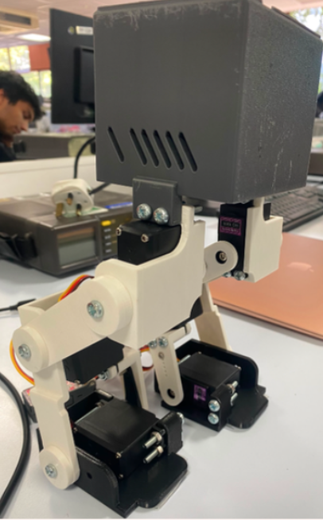
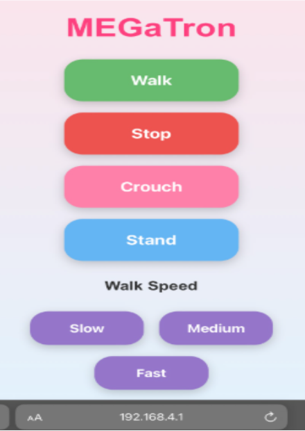
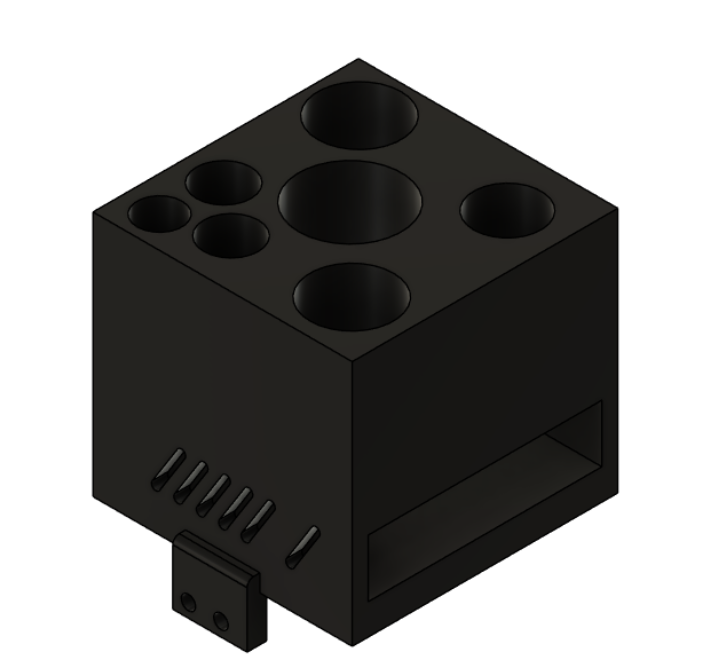
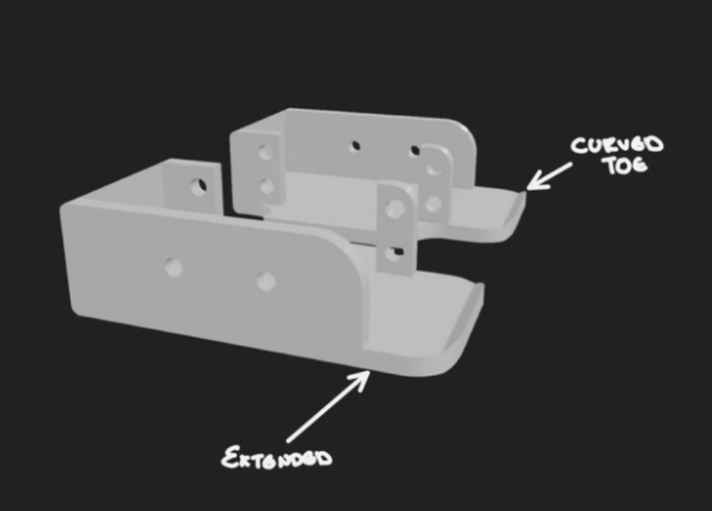
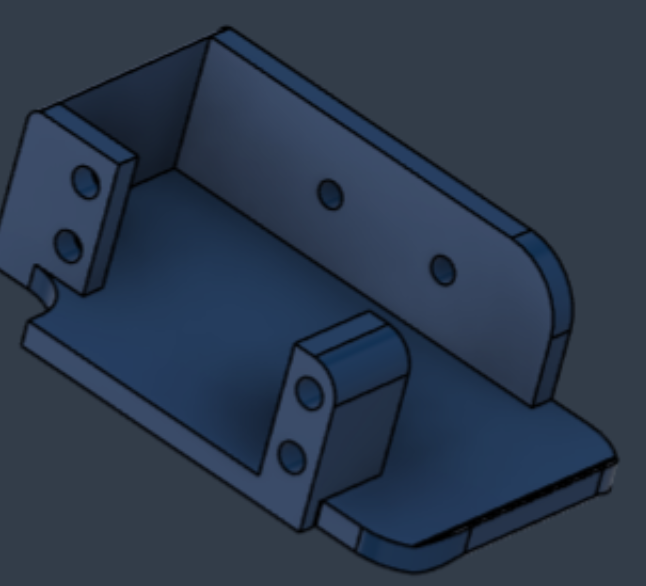

# 🤖 MEGaTron - Wi-Fi Controlled Bipedal Robot

  

## Overview

MEGaTron is a six-servo bipedal robot developed as part of an undergraduate Electronic & Computer Engineering team project at the University of Kent.

The project involved developing an existing robotic platform through embedded programming, mechanical redesign, wireless communication, servo calibration, and iterative testing.

The robot uses an ESP32-based controller to host a local Wi-Fi network and web interface, allowing users to control standing, crouching, and walking movements from a smartphone.

## Key Features

- Six-servo robotic motion control
- Smartphone-based Wi-Fi control interface
- Standing and squatting movements
- Four-phase walking gait
- Smooth servo interpolation
- Three selectable movement speeds
- Password-protected local Wi-Fi access
- Custom 3D-printed mechanical components
- Real-time servo calibration interface

## My Contributions

**Role: Team Lead & Software Lead**

I coordinated the team throughout the nine-week development period and jointly developed the robot's main control system.

My technical contributions included:

- Co-developing the gait algorithm and six-servo movement control.
- Implementing and refining servo interpolation for smoother transitions.
- Independently developing a web-based servo calibration tool with six adjustable sliders.
- Testing servo positions, gait timing, and power supply behaviour.
- Supporting the development and verification of the Wi-Fi control interface.
- Coordinating software integration with mechanical design changes.

## Servo Calibration Tool

I independently developed a web-based calibration tool
that allowed all six servo joints to be adjusted in
real time using sliders on a smartphone.

The interface was hosted directly on the ESP32
microcontroller and communicated with the robot
over its local Wi-Fi network.

This significantly simplified gait development,
allowing servo positions to be tested and refined
without repeatedly modifying and uploading firmware.

The calibrated joint positions were subsequently
used in the robot's walking algorithm.

The main robot firmware was developed collaboratively with another software lead. Mechanical design and other project contributions were completed by fellow team members.
[View my servo calibration firmware](firmware/servo_calibration/servo_calibration.ino)

## Technologies

- ESP32 / M5StickS3
- Arduino C++
- M5Stack 8Servo Unit
- Wi-Fi and embedded web server
- Autodesk Fusion 360
- 3D printing

## Wireless Control Interface

The ESP32-based controller hosts a local Wi-Fi network
and web interface, allowing the robot to receive
movement commands from a smartphone.

The interface provides controls for walking, stopping,
standing, crouching, and selecting movement speed.

## Mechanical Design

The team developed several mechanical improvements
to increase the robot's stability and load-bearing
capability.

### Payload and Battery Housing

The final housing includes seven individual compartments
designed to prevent payload movement during operation.

### Foot Redesign

The redesigned feet feature extended geometry and curved
toes to improve ground contact and reduce snagging during
movement.

### CAD Component

## Results

| Performance measure | Result |
|---|---|
| Standing load capacity | 800 g |
| Squatting load capacity | 650 g |
| Maximum squat depth | Approximately 18 cm |
| Wireless control | Successfully demonstrated |
| Standing and squatting | Successfully demonstrated |
| Walking | Forward movement achieved; stability remained limited |

## Engineering Challenges

The main technical challenge was achieving stable locomotion. Small changes in servo angles, mechanical geometry, and weight distribution significantly affected balance.

To improve performance, the software team developed smoother servo transitions and refined the walking sequence through repeated physical testing.

The project also required coordination between mechanical and software development, as modifications to the robot's structure frequently required servo recalibration.

## Limitations and Future Improvements

The robot successfully demonstrated wireless control, standing, squatting, and load support. However, stable continuous bipedal walking was not achieved within the project timeframe.

Potential improvements include:

- Adding an IMU for feedback-based balance control.
- Developing closed-loop gait correction.
- Improving the robot's centre of mass.
- Implementing more advanced walking algorithms.
- Further optimising servo timing and energy consumption.

## Project Documentation

The project presentation provides an overview of
the robot's development, mechanical design,
software implementation, testing and results.

[View MEGaTron Project Presentation](docs/MEGaTron_Project_Presentation.pdf)

## Project Context

Developed by Team MEGaTron as part of the University of Kent Engineering Team Project.

This repository documents the collaborative project and highlights my individual software development, testing, and team leadership contributions.
